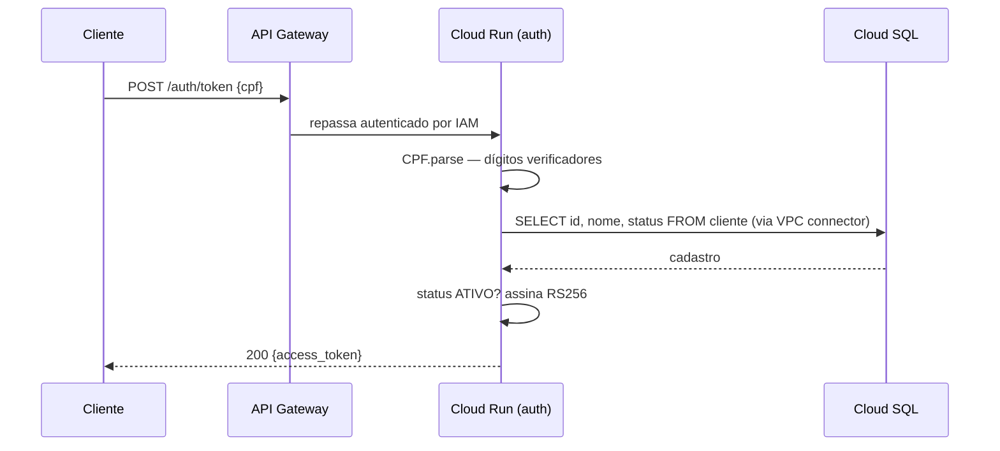

# tech-challenge-auth

Serviço de autenticação de clientes da oficina. Recebe um CPF, confere o cadastro
no banco e devolve um JWT RS256 que os demais serviços validam offline pelo JWKS
publicado aqui.

Não há senha: o CPF é o único fator. O serviço prova identidade contra o cadastro,
não posse de um segredo — ver [Limitações conhecidas](#limitações-conhecidas).

## Endpoints

| Método | Caminho | Resposta |
| --- | --- | --- |
| `POST` | `/auth/token` | `200` com o token, `400` CPF inválido, `401` cliente inexistente ou inativo, `503` falha interna |
| `GET` | `/.well-known/jwks.json` | `200` com o JWK Set (`public, max-age=300`) |
| `GET` | `/.well-known/openid-configuration` | `200` com os metadados do emissor (`public, max-age=3600`) |

Emissão de token:

```bash
curl -X POST "$ISSUER/auth/token" \
  -H 'Content-Type: application/json' \
  -d '{"cpf":"529.982.247-25"}'
```

```json
{
  "access_token": "eyJraWQiOiI...",
  "token_type": "Bearer",
  "expires_in": 3600
}
```

O CPF é aceito com ou sem máscara. Os erros seguem o formato do OAuth 2.0
(`invalid_request`, `invalid_grant`, `temporarily_unavailable`):

```json
{ "error": "invalid_request", "error_description": "CPF inválido" }
```

### Claims do token

`iss`, `sub` (o `id` do cliente), `aud`, `iat`, `nbf`, `exp`, `jti`, mais `name` e
`roles: ["CLIENTE"]`. O header leva `kid` — o thumbprint da chave — para que o
consumidor escolha a chave certa no JWKS.

## Arquitetura

Arquitetura hexagonal em quatro camadas, com as dependências sempre apontando para
o domínio. As regras estão expressas como testes executáveis em
`src/test/kotlin/.../architecture/ArquiteturaTest.kt` (Konsist), não só como
convenção: o domínio não conhece nenhuma outra camada nem framework algum, as portas
da aplicação não expõem detalhes técnicos, e a infraestrutura não depende da
apresentação.

```text
domain          CPF, Cliente, StatusCliente, ClienteRepository (interface)
application     AutenticarClienteUseCase + portas EmissorDeToken, ChavesPublicas
infrastructure  JdbcClienteRepository, NimbusTokenAdapter, config, DI (Koin)
presentation    Servidor (Ktor CIO), AuthRoutes
```



O acesso ao banco é só leitura em três níveis: o papel `auth_ro` tem `SELECT` em
quatro colunas e `default_transaction_read_only`, e o pool do Hikari sobe com
`isReadOnly`.

## Rodando local

Requer JDK 21 (o Gradle resolve o toolchain sozinho) e um Postgres.

### 1. Banco

```bash
docker run -d --name oficina-db -p 5432:5432 \
  -e POSTGRES_PASSWORD=local -e POSTGRES_DB=oficina postgres:16
```

```bash
docker exec -i oficina-db psql -U postgres -d oficina <<'SQL'
CREATE TABLE cliente (
  id     uuid PRIMARY KEY,
  nome   text NOT NULL,
  cpf    text NOT NULL,
  status text NOT NULL
);
INSERT INTO cliente VALUES
  (gen_random_uuid(), 'Cliente Ativo',   '52998224725', 'ATIVO'),
  (gen_random_uuid(), 'Cliente Inativo', '11144477735', 'INATIVO');
SQL
```

O `SELECT` casa o CPF com e sem máscara (`WHERE cpf IN (?, ?)`), então qualquer um
dos dois formatos serve na coluna.

### 2. Chave de assinatura

PKCS#8, no mínimo 2048 bits — é o que o `RsaKeyLoader` exige:

```bash
openssl genpkey -algorithm RSA -pkeyopt rsa_keygen_bits:2048 -out jwt-private.pem
```

### 3. Subir

```bash
export ISSUER=http://localhost:8081
export JWT_PRIVATE_KEY="$(cat jwt-private.pem)"
export DB_URL=jdbc:postgresql://localhost:5432/oficina
export DB_USER=postgres
export DB_PASSWORD=local

./gradlew run
```

`./gradlew run` escuta na **8081** de propósito, deixando a 8080 livre para o resto
do stack na máquina.

## Variáveis de ambiente

| Variável | Obrigatória | Padrão | Observação |
| --- | --- | --- | --- |
| `ISSUER` | sim | — | URL do emissor; precisa começar com `http`. A barra final é descartada |
| `JWT_PRIVATE_KEY` | sim | — | PEM PKCS#8. Aceita `\n` escapado, para caber em variável de ambiente |
| `DB_URL` | sim | — | JDBC do Postgres |
| `DB_USER` | sim | — | `auth_ro` em produção |
| `DB_PASSWORD` | sim | — | vem do Secret Manager |
| `AUDIENCE` | não | `oficina` | claim `aud` |
| `TOKEN_TTL_SECONDS` | não | `3600` | precisa ser positivo |
| `PORT` | não | `8080` | injetada pelo Cloud Run; valor inválido cai no padrão em vez de derrubar a instância |

Ausência de uma obrigatória derruba a aplicação na partida, não na primeira
requisição. `TokenSettings` e `DatabaseSettings` sobrescrevem `toString()` para que
chave e senha nunca apareçam em log.

## Qualidade

```bash
./gradlew check        # formatação + análise estática + testes + cobertura
./gradlew qualidade    # só Spotless e detekt
./gradlew test         # testes, já gerando o relatório do Jacoco
```

- **Spotless/ktlint** é o único formatador; o estilo vem exclusivamente do
  `.editorconfig`. O ruleset de formatação do detekt fica desligado para não haver
  dois donos do mesmo arquivo.
- **detekt** com baseline em `config/detekt/detekt-baseline.xml`.
- **Jacoco** com mínimo de 90% de instruções e 80% de branches, verificado no
  `check`. O relatório sai em `build/reports/jacoco/test/` e o CI o publica como
  artefato em toda execução. O `main()` do `Servidor.kt` está fora da medição: sobe
  um servidor de verdade e nenhum teste o executa sem subir o processo.

## Pipeline

Gitflow, com um workflow por responsabilidade.

| Workflow | Dispara em | Faz |
| --- | --- | --- |
| `ci.yml` | PR para `develop` ou `main`; `workflow_call` | Um job por checagem: formatação, análise estática, testes com cobertura, fat JAR |
| `cd-homolog.yml` | push em `release/**`; manual | Chama o CI, constrói e publica a imagem, faz deploy em homologação, roda smoke test |
| `cd-prod.yml` | push em `main`; manual | Resolve o digest da revisão no ar em homologação, promove **essa** imagem para produção, roda smoke test |

Produção nunca constrói imagem. O `cd-prod.yml` lê o digest do que está servindo em
homologação e faz deploy dele, então o artefato aprovado é bit a bit o artefato
promovido.

## Infraestrutura

Terraform em `terraform/`, estado em GCS (`oficina-tfstate`, prefixo `auth`).
Provisiona Artifact Registry, o serviço do Cloud Run, VPC connector, API Gateway,
service accounts e o secret da chave de assinatura.

A VPC e o secret da senha do banco **não** nascem aqui — vêm do
`tech-challenge-infra-database` e são lidos como `data`. Aplique aquele primeiro.

O Terraform cria o serviço do Cloud Run uma única vez, só para que o endereço exista
e possa ser apontado no backend do gateway; todo o runtime (imagem, variáveis,
secrets, escala) pertence ao deploy no GitHub Actions, e por isso o `template` está
inteiro em `ignore_changes`. Essa divisão quebra o ciclo
`ISSUER → hostname do gateway → backend → URL do serviço`, que impediria descrever
tudo num `apply` só.

```bash
cd terraform
cp terraform.tfvars.example terraform.tfvars   # preencha project_id e ci_service_account_id
terraform init
terraform apply
```

### Passos manuais depois do apply

O `apply` cria o secret `jwt-signing-key` **vazio**. Sem uma versão com o PEM, a
primeira revisão do serviço sobe e morre na leitura da configuração:

```bash
openssl genpkey -algorithm RSA -pkeyopt rsa_keygen_bits:2048 -out jwt-private.pem
gcloud secrets versions add jwt-signing-key --data-file=jwt-private.pem
rm jwt-private.pem
```

O papel de leitura no banco também é uma execução única, com o usuário administrador
do Cloud SQL — a senha vem do Secret Manager, nunca do arquivo:

```bash
psql -v senha="$(gcloud secrets versions access latest --secret=db-auth-password)" \
  -f sql/auth_ro.sql
```

Por fim, configure no GitHub os environments `staging` e `production` com as
variáveis `GCP_PROJECT_ID`, `REGION`, `AUTH_ISSUER` (o output `issuer`), `DB_URL` e o
secret `GCP_SA_KEY`.

## Limitações conhecidas

- **CPF como único fator.** Quem souber um CPF válido de cliente ativo obtém token.
  O endpoint é público no gateway e não tem rate limit — uma quota no API Gateway é o
  próximo passo natural.
- **Sem rotação de chave.** O JWKS publica uma única chave. Rotacionar hoje invalida
  os tokens em circulação, porque não há período de sobreposição com duas chaves.
- **`JdbcClienteRepository` sem teste de integração.** Os testes usam fakes de JDBC,
  então o SQL não é executado contra um Postgres de verdade; um erro de coluna ou
  tipo só apareceria em runtime. O smoke test do CD cobre o JWKS e o `400`, não o
  caminho de sucesso.
