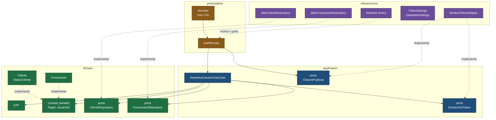
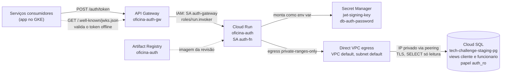
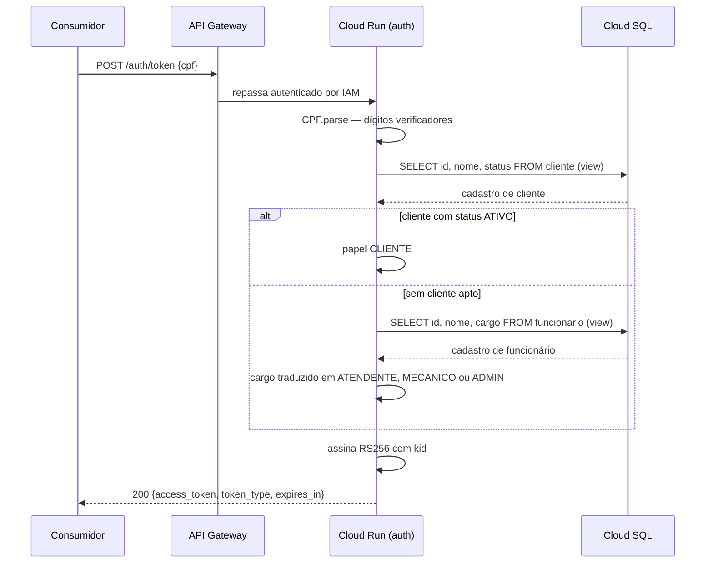
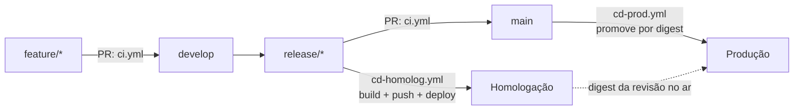

# Arquitetura — tech-challenge-auth

Diagramas do serviço de autenticação. Para o propósito, a stack e os passos de
execução e deploy, ver o [README](../README.md).

Os diagramas são mermaid, renderizados pelo próprio GitHub. A fonte fica neste
arquivo para que uma mudança de arquitetura apareça como diff revisável, não como
binário trocado.

## Imagens exportadas

Para usar fora do GitHub — slides, PDF da entrega, documentos — cada diagrama
também está como SVG:

| Diagrama | Arquivo |
| --- | --- |
| Camadas (hexagonal) | [arquitetura-camadas.svg](arquitetura-camadas.svg) |
| Runtime no GCP | [arquitetura-runtime-gcp.svg](arquitetura-runtime-gcp.svg) |
| Fluxo de uma emissão | [arquitetura-fluxo-emissao.svg](arquitetura-fluxo-emissao.svg) |
| Fluxo de entrega | [arquitetura-fluxo-entrega.svg](arquitetura-fluxo-entrega.svg) |

Os SVGs usam só `<text>` nativo, sem `<foreignObject>` e sem fonte embutida em
base64, então abrem em PowerPoint, Illustrator e Inkscape — não apenas no
navegador. É para isso que serve o `mermaid.config.json` deste diretório:
`htmlLabels: false` troca os rótulos em HTML por texto SVG, e `wrappingWidth`
evita que nomes longos como `JdbcClienteRepository` quebrem no meio da palavra.

**São arquivos gerados.** Ao mudar um diagrama acima, regenere o SVG
correspondente — salve o bloco mermaid num arquivo `.mmd` e rode:

```bash
npx -y @mermaid-js/mermaid-cli   -i arquitetura-camadas.mmd   -o docs/arquitetura-camadas.svg   -b white -c docs/mermaid.config.json
```

## Camadas (hexagonal)

Quatro camadas, com as dependências sempre apontando para o domínio. As regras não
são convenção: estão expressas como teste executável em
`src/test/kotlin/.../architecture/ArquiteturaTest.kt` (Konsist) — o domínio não
conhece nenhuma outra camada nem framework algum, as portas da aplicação não expõem
detalhes técnicos, e a infraestrutura não depende da apresentação.



As setas pontilhadas são as inversões: `JdbcClienteRepository`,
`JdbcFuncionarioRepository` e `NimbusTokenAdapter` vivem na infraestrutura mas
implementam contratos declarados nas camadas de dentro. Trocar Postgres por outro
banco, ou Nimbus por outra biblioteca de JOSE, não toca domínio nem aplicação.

`Usuario` é a interface selada que fecha o conjunto de identidades: `Cliente` e
`Funcionario`. É o que permite ao caso de uso tratar os dois cadastros pelo mesmo
caminho e ao emissor montar o token sabendo apenas `id`, `nome` e `papel` — a
origem do cadastro não vaza para fora do domínio.

## Runtime no GCP



O Cloud Run roda com `--no-allow-unauthenticated`: o único chamador autorizado é a
service account do gateway.

A saída para o banco usa **Direct VPC egress**: as instâncias do Cloud Run entram
direto na subnet `default`, sem as VMs de um conector de Serverless VPC Access e,
portanto, sem custo fixo de rede. O egress é `private-ranges-only`: só o tráfego
para faixas privadas (o Cloud SQL) passa pela VPC, e o resto segue pela saída
padrão do Cloud Run, sem exigir Cloud NAT.

O banco pertence a outros dois repositórios: a instância e o peering ao
`tech-challenge-database`, e o schema ao Flyway da aplicação (`Tech-Challenge`).
Este serviço lê apenas as views `cliente` e `funcionario`, que a aplicação publica
como contrato de leitura (migration V16). O acesso é só leitura em três níveis: o
papel `auth_ro` tem `SELECT` em quatro colunas de cada view, mais
`default_transaction_read_only`, e o pool do Hikari sobe com `isReadOnly`.

O Terraform cria o serviço do Cloud Run uma única vez, só para que o endereço exista
e possa ser apontado no backend do gateway; todo o runtime pertence ao deploy no
GitHub Actions. Essa divisão quebra o ciclo
`ISSUER → hostname do gateway → backend → URL do serviço`.

## Fluxo de uma emissão



A view `cliente` é consultada primeiro por duas razões que apontam para o mesmo
lado: é o caso comum, resolvido numa única consulta, e um CPF cadastrado nos dois
lugares acaba recebendo o papel de menor privilégio. A segunda consulta só acontece
quando a primeira não produz ninguém apto — inclusive quando o cliente existe mas
está inativo, para que um cadastro inativo não esconda o cadastro de funcionário do
mesmo CPF.

Cadastro inexistente, cliente inativo e cargo que o domínio não reconhece produzem
todos a mesma resposta `401` (`invalid_grant`), de propósito: a diferença revelaria
quais CPFs têm cadastro e em qual lugar.

Com a instância Cloud SQL desligada (o padrão fora de uso, por custo), a consulta
falha e o serviço responde `503` (`temporarily_unavailable`). O JWKS e o discovery
continuam respondendo, porque não dependem do banco.

## Fluxo de entrega



Produção nunca constrói imagem. O `cd-prod.yml` lê o digest do que está servindo em
homologação e faz deploy dele, então o artefato aprovado é bit a bit o artefato
promovido.
