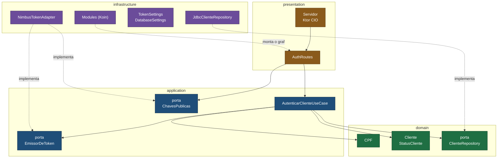
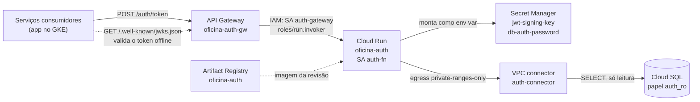
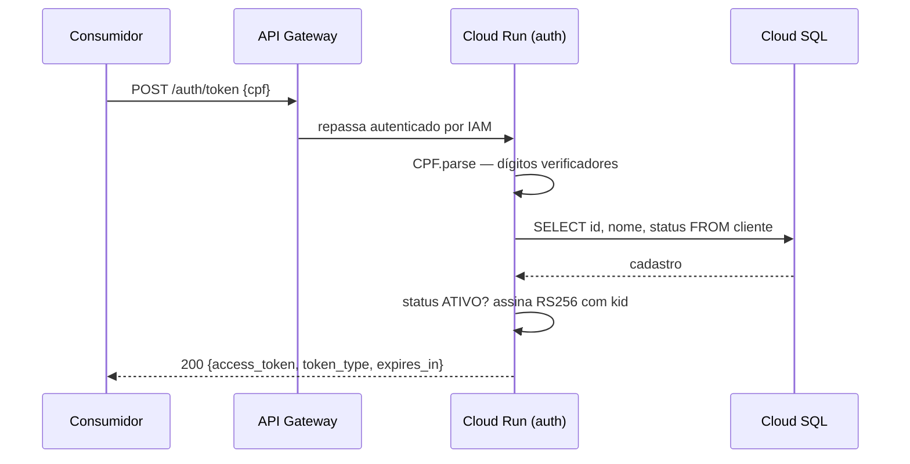
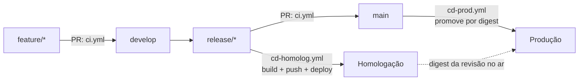

# Arquitetura — tech-challenge-auth

Diagramas do serviço de autenticação. Para o propósito, a stack e os passos de
execução e deploy, ver o [README](../README.md).

Os diagramas são mermaid, renderizados pelo próprio GitHub. A fonte fica neste
arquivo para que uma mudança de arquitetura apareça como diff revisável, não como
binário trocado.

## Camadas (hexagonal)

Quatro camadas, com as dependências sempre apontando para o domínio. As regras não
são convenção: estão expressas como teste executável em
`src/test/kotlin/.../architecture/ArquiteturaTest.kt` (Konsist) — o domínio não
conhece nenhuma outra camada nem framework algum, as portas da aplicação não expõem
detalhes técnicos, e a infraestrutura não depende da apresentação.

As setas pontilhadas são as inversões: `JdbcClienteRepository` e
`NimbusTokenAdapter` vivem na infraestrutura mas implementam contratos declarados
nas camadas de dentro. Trocar Postgres por outro banco, ou Nimbus por outra
biblioteca de JOSE, não toca domínio nem aplicação.

## Runtime no GCP

O Cloud Run roda com `--no-allow-unauthenticated`: o único chamador autorizado é a
service account do gateway. O acesso ao banco é só leitura em três níveis — o papel
`auth_ro` tem `SELECT` em quatro colunas e `default_transaction_read_only`, e o pool
do Hikari sobe com `isReadOnly`.

O Terraform cria o serviço do Cloud Run uma única vez, só para que o endereço exista
e possa ser apontado no backend do gateway; todo o runtime pertence ao deploy no
GitHub Actions. Essa divisão quebra o ciclo
`ISSUER → hostname do gateway → backend → URL do serviço`.

## Fluxo de uma emissão

Cliente inexistente e cliente inativo produzem a mesma resposta `401`
(`invalid_grant`), de propósito: a diferença revelaria quais CPFs têm cadastro.

## Fluxo de entrega

Produção nunca constrói imagem. O `cd-prod.yml` lê o digest do que está servindo em
homologação e faz deploy dele, então o artefato aprovado é bit a bit o artefato
promovido.
